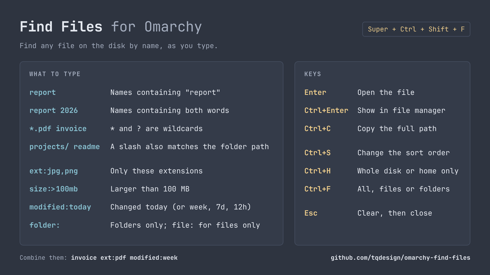

# Find Files

Find any file on the disk by name as you type, like
[Everything](https://www.voidtools.com/) on Windows. Built as an
[Omarchy](https://omarchy.org/) shell plugin for Hyprland.



- Answers from the `plocate` index, so a whole-disk search takes milliseconds.
- Also scans your home folder for files newer than the index, so something you
  saved a minute ago still shows up.
- Shows name, folder, size and modified date, with the matching letters
  highlighted; sorts by relevance, name, date or size.
- Filters by extension, size, date and kind.

## Searching

| You type | It finds |
| --- | --- |
| `report` | Names containing "report", any case |
| `report 2026` | Names containing both words |
| `*.pdf invoice` | PDFs with "invoice" in the name; `*` and `?` are wildcards |
| `projects/ readme` | "readme" where the path contains "projects/" |
| `ext:mp4 size:>100mb` | Videos over 100 MB |
| `ext:jpg,png holiday` | JPEGs and PNGs with "holiday" in the name |
| `modified:today` | Everything changed today in your home folder |
| `report modified:week` | "report" files changed in the last 7 days |
| `report folder:` | Folders only; `file:` for files only |

Filters:

| Filter | Values |
| --- | --- |
| `ext:` | One extension or a comma-separated list |
| `size:` | `>`, `<`, `>=` or `<=`, a number, and `b`, `kb`, `mb` or `gb` |
| `modified:` | `today`, `yesterday`, `week`, `month`, `year`, or a count such as `7d` or `12h`. Put `>` in front for "longer ago than", as in `modified:>30d` |
| `file:` `folder:` | Only files, or only folders |

A date filter with no name, such as `modified:today`, lists the home folder
only: the index holds names, not dates, so there is nothing to ask it.

The Trash is always left out of the results.

Searching starts at the second character. One letter would make `plocate` read
every name on the disk, which takes about a second.

## Keys

| Key | Action |
| --- | --- |
| `Enter`, double-click | Open the file |
| `Ctrl+Enter` | Show it in the file manager |
| `Ctrl+C` | Copy its full path |
| `Ctrl+S` | Cycle the sort: relevance, name, modified, size |
| `Ctrl+H` | Switch between the whole disk and the home folder only |
| `Ctrl+F` | Cycle between everything, files only and folders only |
| `Up` `Down` `PgUp` `PgDn` | Move the selection |
| `Ctrl+Backspace`, `Ctrl+U` | Delete a word, clear the box |
| `Esc` | Clear the box, then close |

## Install

```bash
omarchy plugin add https://github.com/tqdesign/omarchy-find-files.git --enable
```

Add the hotkey (`Super+Ctrl+Shift+F`) to `~/.config/hypr/bindings.lua`:

```lua
dofile(os.getenv("HOME") .. "/.config/omarchy/plugins/tqdesign.find-files/hypr/find-files.lua")
```

Validate with `hyprctl reload && hyprctl configerrors`. Or bind
`omarchy-shell shell toggle tqdesign.find-files` to a key of your own.

Needs `plocate`, `fd` and `python`, all of which Omarchy installs.

## How fresh are the results

`plocate` reads an index that `updatedb` rebuilds once a day; the footer shows
its age. Between rebuilds:

- New and changed files under your home folder are found anyway, by an `fd`
  scan for anything modified since the index was built. `.git`, `node_modules`
  and `.cache` are skipped.
- New files elsewhere on the disk don't appear until the next rebuild.
- Deleted files are dropped from the results, since each match is checked on
  disk before it is shown.

To rebuild now, run `sudo updatedb`. To rebuild more often, give
`plocate-updatedb.timer` a drop-in with a shorter `OnCalendar`.

## Limits

- At most 3,000 index matches are ranked and 300 shown; narrow the search if
  the footer says "Over". The home-only search takes a wider net of 30,000.
- `updatedb` skips `/tmp`, `/mnt`, `/media` and network mounts by default; see
  `/etc/updatedb.conf`.

## License

MIT
